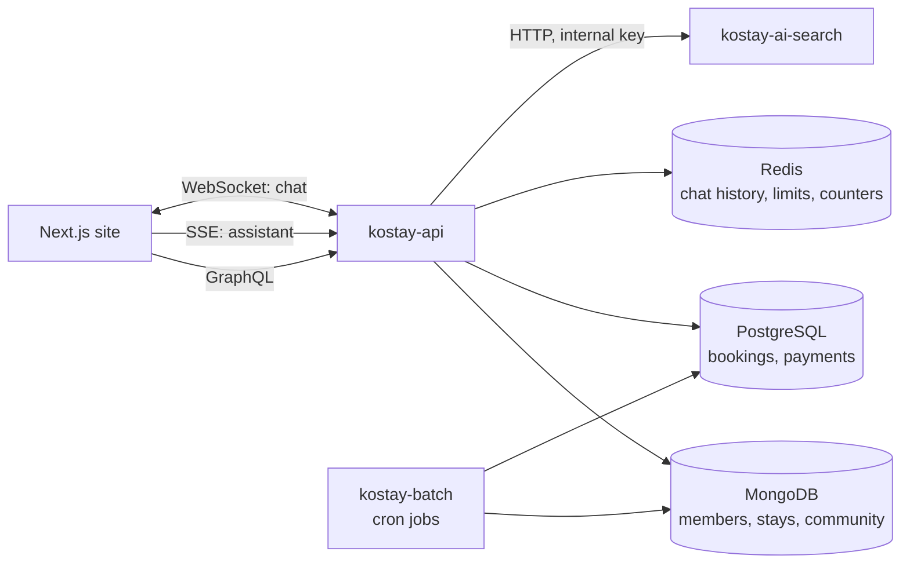

# Kostay API

Backend of [Kostay](https://kostay.kr), a booking platform for stays in South Korea: apartments,
villas, houses and hanoks in eight cities. Guests search by city and dates and book at once; hosts
list their stays and follow reservations and earnings; admins moderate stays, members, bookings and
the help center.

A NestJS monorepo with two apps that share one code base and one Docker image:

- **kostay-api**: a GraphQL API (65 queries and mutations), one REST endpoint that streams the
  assistant's answers, and a WebSocket chat.
- **kostay-batch**: scheduled jobs (rankings, finishing stays after check-out).

Related repositories: [kostay-next](https://github.com/mryaryyev/kostay-next) (the Next.js site)
and [kostay-ai-search](https://github.com/mryaryyev/kostay-ai-search) (natural-language search and
the assistant).

## Architecture



## Three stores, each for what it is good at

| Store | Holds | Why |
|---|---|---|
| MongoDB (Mongoose) | members, stays, community articles, comments, likes, views, follows, notifications, notices and FAQ, inquiries | Flexible documents and counters; likes, views and comments are one collection each that serves members, stays and articles (group + reference id) |
| PostgreSQL (TypeORM, migrations) | bookings, payments | Money and dates need transactions and constraints |
| Redis | chat history, the assistant's rate limits, Smart Search counters | Short-lived data; the API keeps working when Redis is down |

Bookings point to MongoDB ids stored as `varchar(24)`; there are no cross-database joins. Booking
rows are read from PostgreSQL, then the stay and guest details are attached with one MongoDB query each.

## Bookings

The part that must not go wrong (`components/booking`, `database/postgres`):

- **One transaction.** Instant Book saves a confirmed booking and its payment together, or nothing
  at all, so an unpaid booking never blocks dates.
- **The price is calculated on the server**: nights × the stay's price per night. An amount sent by
  the client is never used.
- **No double booking, guaranteed by the database.** The service checks availability first, but two
  requests can arrive at the same moment. An exclusion constraint
  (`EXCLUDE USING gist (property_id WITH =, daterange(check_in, check_out) WITH &&)` over active
  bookings) makes the second one fail; the API answers that the dates were just taken.
- **Check-out day is free for the next guest**: the date range is half-open.
- **Cancel and refund in one transaction**, by the guest or by an admin; the other side gets a
  notification after the commit.
- Search results leave out stays that are booked for the requested dates, and a public query returns
  a stay's booked ranges without any guest data.

## Access control

- Passwords are hashed with bcrypt; a login returns a JWT. Ten login attempts per five minutes per IP.
- The server decides role and status: a signup creates a guest or a host, a profile update accepts
  profile fields only, and every request reads the member's current role and status from MongoDB.
- Three guards: `AuthGuard` (signed in), `RolesGuard` with `@Roles(...)` (host or admin only) and
  `WithoutGuard` (public, but knows the member when a token is sent).
- Every input is a DTO validated with class-validator through a global `ValidationPipe`.

## AI features

The AI runs in a separate service; this API is the only thing that talks to it.

- **Smart Search**: the query is sent to kostay-ai-search, which returns ranked stay ids and the
  filters it understood. If the service is down or slower than 8 seconds, the API falls back to
  keyword search, so search never breaks. Requests and fallbacks are counted per day in Redis for
  the admin page.
- **Index sync**: when a stay is created, changed or removed, the change is sent to the AI service
  without waiting for the answer. A failure there cannot slow down or break the host's request.
- **Assistant** (`POST /assistant/stream`): REST instead of GraphQL, because the answer streams as
  Server-Sent Events. The API passes the stream through, adds stay cards and host cards (the hosts
  with the most active stays in the asked city) from MongoDB to the final event, and stops the upstream request when the visitor closes the page. Limits in Redis: 10
  questions per minute per IP and 1,000 per day in total.

## Scheduled jobs

Times are Asia/Seoul.

| When | Job |
|---|---|
| 01:00:00 | Reset the ranks of active stays and hosts |
| 01:00:20 | Rank stays: likes × 2 + views |
| 01:00:40 | Rank hosts: stays × 5 + articles × 3 + likes × 2 + views |
| 11:05 | Mark confirmed bookings as completed once their check-out day has come (check-out is 11:00) |

## Also in the API

- **Community**: four boards (free, recommend, news, humor) with comments, likes and view counts.
- **Follows and notifications** for likes, comments, follows, bookings and inquiries.
- **Help center**: notices, FAQ in groups, and 1:1 inquiries that admins answer.
- **Hosts**: their stays, reservations and earnings (revenue from PostgreSQL payments).
- **Admin**: dashboard totals, members, stays, bookings with refunds, community and help center.
- **Live chat** over WebSocket: everyone reads, members write, and a message shows only nickname
  and photo. The last 50 messages are kept in a Redis list, with a copy in memory for when Redis
  is down.
- **Image upload**: photos are rotated as taken, resized and saved as WebP.

## Run locally

You need Node.js 22, a MongoDB database, a PostgreSQL database and Redis.

```bash
npm install
cp .env.example .env          # fill in the connection strings and the token secret
npm run migration:run         # creates the bookings and payments tables
npm run start:dev             # API, GraphQL playground at http://localhost:3007/graphql
npm run start:dev:batch       # batch jobs, in a second terminal
```

`AI_SEARCH_URL` is optional: without it Smart Search uses keyword search and the assistant is off.

## Tests

```bash
npm test
```

21 unit tests cover the member role rules and the assistant proxy: the rate limiter, the
Server-Sent Events parser, input validation, the service and its stay and host cards. CI runs lint, both builds and the tests
on every pull request.

## Deploy

One multi-stage Docker image runs both apps (the batch container overrides the command). Docker
Compose starts the API, the batch app and Redis; uploaded images live in a folder on the host, so
they survive new deploys. On the server:

```bash
./deploy.sh        # pull main, build the new image, swap the containers
```

## Project structure

```text
apps/kostay-api/src/
  components/      one module per feature: resolver, service (auth, member, property, booking,
                   board-article, comment, like, view, follow, notification, notice, inquiry,
                   dashboard, ai-search, assistant)
  database/        MongoDB, PostgreSQL (entities, migrations) and Redis modules
  libs/            DTOs, enums, config, image processing, logging interceptor
  schemas/         Mongoose schemas
  socket/          WebSocket chat gateway
apps/kostay-batch/src/   cron jobs
```

## Stack

TypeScript, NestJS 10, GraphQL (Apollo Server), Mongoose, TypeORM, PostgreSQL, MongoDB, Redis
(ioredis), WebSocket (ws), JWT, bcrypt, class-validator, sharp, Jest, Docker.
